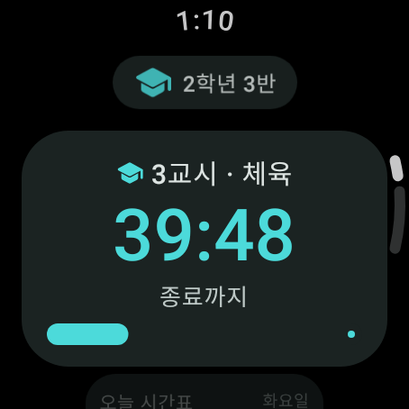
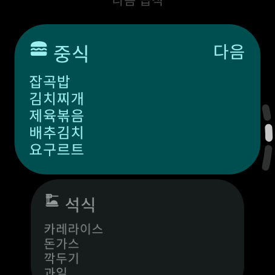
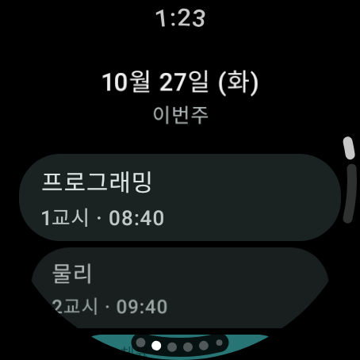
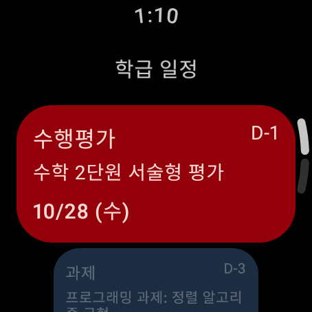
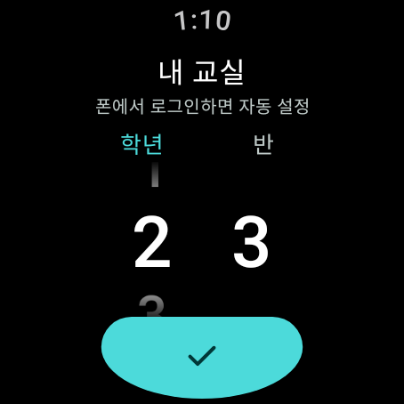
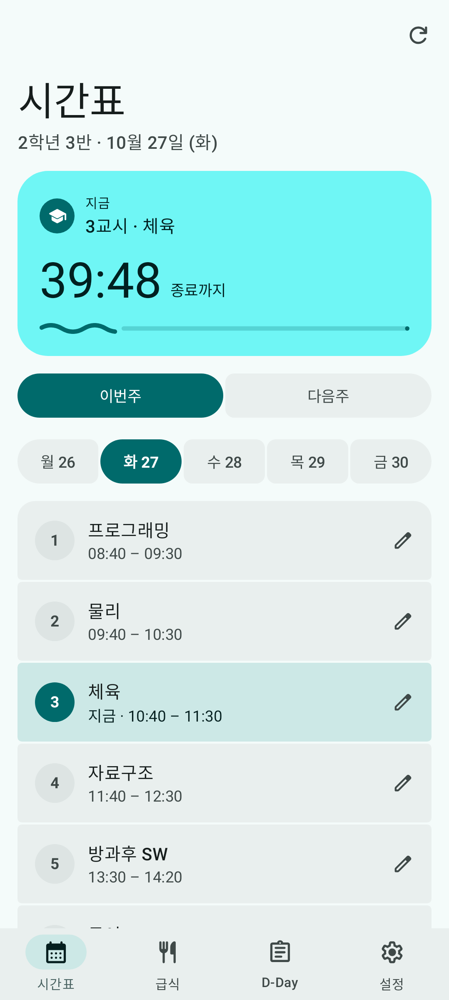
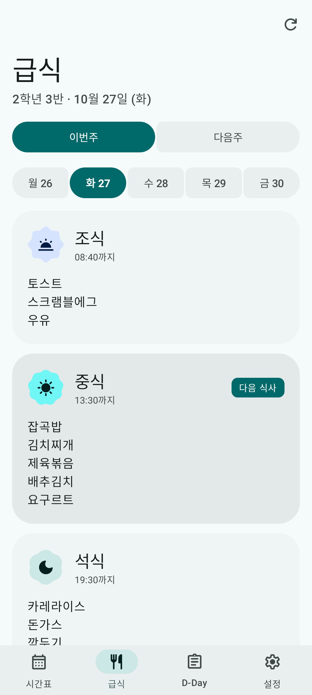
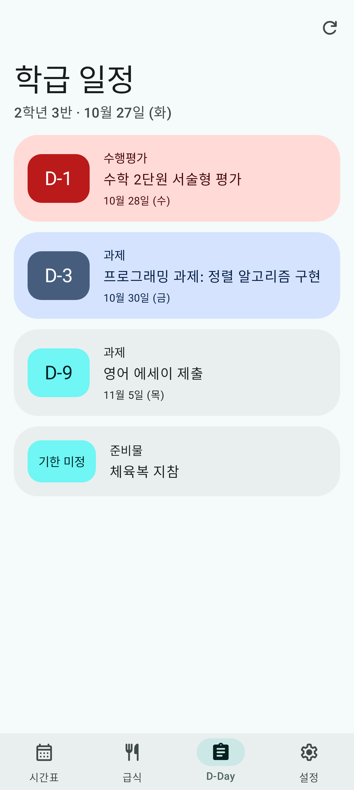
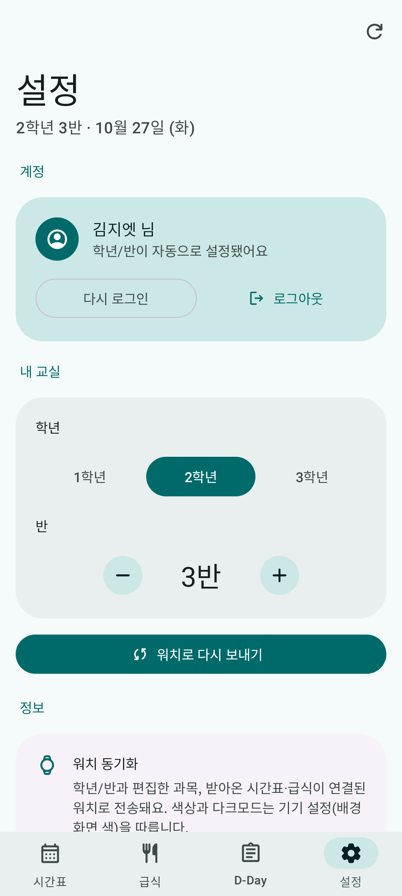
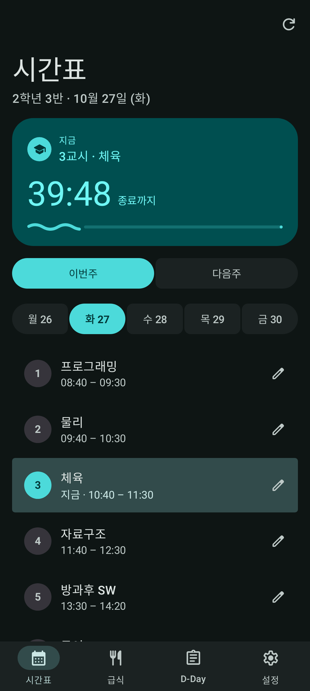

<h1 align="center">
  ⌚ GSMwatch
</h1>

<p align="center">
  <a href="https://github.com/minulx-10/GSMwatch/blob/master/LICENSE"></a>
  <a href="https://github.com/minulx-10/GSMwatch/releases"></a>
  <a href="https://www.android.com/wear-os/"></a>
</p>

<p align="center">광주소프트웨어마이스터고등학교 학생들을 위한 <b>Wear OS 워치 앱 + 휴대폰 컴패니언 앱</b>입니다.</p>

---

# 📖 프로젝트 개요

GSMwatch는 광주소프트웨어마이스터고등학교(GSM) 학생들의 시간 관리를 돕기 위해 기획된 앱입니다. 스마트폰을 확인하기 어려운 상황에서도 손목(Wear OS)에서 직관적으로 일과를 확인할 수 있으며, 페어링된 **휴대폰 컴패니언 앱(GSMhub)** 에서 시간표·과목을 편하게 편집하고 워치로 동기화할 수 있습니다.

### 🎯 주요 기능
1. **'지금' 카운트다운:** 진행 중인 교시·일과가 끝날 때까지, 쉬는 틈·새벽엔 다음 일과까지, 금요일 종례 후엔 일요일 기숙사 입소까지 남은 시간과 진행률을 보여줍니다.
2. **간편한 조작:** 스와이프·로터리(크라운)만으로 이번주·다음주 시간표, 식단, D-Day를 넘겨 봅니다.
3. **Wear 타일:** 앱을 열지 않아도 워치 타일에서 현재 교시와 남은 시간을 실시간으로 확인합니다.
4. **컴패니언 폰 앱(GSMhub):** 휴대폰에서 학년/반·커스텀 과목을 편집하면 Wear Data Layer 를 통해 워치로 동기화됩니다. 다크모드·동적 색상 지원.
5. **DataGSM 로그인:** 폰에서 GSM 계정으로 로그인하면 학생 본인의 학년/반이 자동 설정되어 워치까지 전송됩니다.
6. **2주치 데이터 & 오프라인 대비:** 이번주·다음주 급식/시간표를 미리 불러오고, 통신이 불안정해도 캐시로 표시를 유지합니다.

---

# 📸 스크린샷

> CI 가 Robolectric + Roborazzi 로 렌더링한 화면입니다(샘플 데이터). 갱신: Actions → **CI** → *Run workflow* (`update_screenshots` 체크).

**⌚ 워치 (Wear OS · Material 3 Expressive)**

| 홈 | 다음 급식 | 주간 시간표 | 학급 일정 | 설정 |
|:-:|:-:|:-:|:-:|:-:|
|  |  |  |  |  |

**📱 폰 (GSMhub · Material 3 Expressive)**

| 시간표 | 급식 | 학급 일정 | 설정 | 시간표 (다크) |
|:-:|:-:|:-:|:-:|:-:|
|  |  |  |  |  |

---

# 🛠 기술 스택 및 아키텍처

**1. 사용 언어 및 UI 프레임워크**
* **Kotlin**: Android 앱 개발을 위해 사용되었습니다.
* **Wear Compose Material 3 (Expressive)**: 원형 디스플레이에 맞춘 `AppScaffold`/`ScreenScaffold`, `TransformingLazyColumn`(스크롤 모핑), `EdgeButton`, `HorizontalPagerScaffold`, `Picker` 등.
* **ProtoLayout Material 3 + Material3TileService**: Wear 타일. 남은 시간·진행률을 동적 표현식으로 렌더러가 직접 갱신합니다.
* **Jetpack Compose Material 3 (1.5 Expressive)**: 폰 앱. 접히는 상단바, `ShortNavigationBar`, 연결형 버튼 그룹, 세그먼트 리스트, 물결 진행률 등.

**2. 디자인 및 데이터 통신**
* **Material 3 Expressive**: 워치·타일·폰 모두 최신 디자인 언어를 따릅니다. 색상은 **동적 색상**(Wear OS 6 워치페이스 / Android 12+ 배경화면)을 쓰고, 지원하지 않는 기기에서는 GSM 틸 브랜드 팔레트를 씁니다. 워치는 배터리 절약을 위해 OLED 검정 배경을 유지합니다.
* **아이콘**: Material Symbols Rounded 벡터(워치·폰 공용).
* **NEIS API 연동**: 공공데이터포털(NEIS) API와 연동하여 학교 급식 및 시간표 정보를 동적으로 불러옵니다. (Retrofit)

**3. 모듈 구조**
* **`:core`** — NEIS/봇 통신·모델·파싱·시간표 조립 로직 (워치/폰 공용 라이브러리).
* **`:app`** — Wear OS 워치 앱 (Jetpack Compose for Wear OS).
* **`:gsmhub`** — 휴대폰 컴패니언 앱 (Jetpack Compose Material3). `:core` 를 공유하며 Wear Data Layer 로 워치와 설정을 동기화합니다.

---

# 🚀 세부 기능

### 1) 2주치 시간표·급식 & 캐시 우선
`java.time` 으로 주간 일정을 계산하고, 이번주와 다음주 데이터를 함께 불러옵니다. 통신이 불안정한 워치는 캐시를 먼저 표시한 뒤 네트워크로 갱신하며, 폰이 받은 데이터를 워치로 전송해 오프라인에서도 표시를 유지합니다.

### 2) D-Day 일정 연동
학급 서버(디스코드 봇)와 연동되어 학생들이 직접 등록한 과제 및 수행평가 일정을 표시합니다. 마감 기한이 임박한 일정은 별도의 색상으로 표시됩니다.

### 3) DataGSM 학생 로그인
폰에서 DataGSM(GSM 학교 OpenAPI/OAuth) 계정으로 로그인하면(OAuth 2.0 + PKCE) 학생 본인의 학년/반이 자동 설정되어 워치까지 동기화됩니다. 급식/시간표는 NEIS, D-Day는 학급 봇을 그대로 사용합니다.

---

# 💻 로컬 빌드 설정

프로젝트 루트에 `local.properties` 를 만들고 아래 값을 설정합니다. (아키텍처·릴리스·인수인계는 **[HANDOVER.md](HANDOVER.md)**, 변경 이력은 **[CHANGELOG.md](CHANGELOG.md)** 참고)

```properties
sdk.dir=<Android SDK 경로>
DATA_GSM_API_KEY="발급받은_NEIS_API_키"          # open.neis.go.kr 발급
BOT_API_URL="학급_D-Day_봇_주소"                 # 선택 (없으면 D-Day 비어있음)
DATAGSM_CLIENT_ID="DataGSM_OAuth_Client_ID"      # 선택 (폰 로그인용, datagsm.kr/clients)
DATAGSM_CLIENT_SECRET="DataGSM_OAuth_Secret"
DATAGSM_REDIRECT_URI="gsmhub://oauth2redirect"
```

> ⚠️ 값은 **따옴표를 포함**해 저장합니다(build.gradle 이 따옴표를 벗겨 사용). 빌드: `./gradlew :app:assembleDebug :gsmhub:assembleDebug`
>
> 테스트: `./gradlew :core:testDebugUnitTest` · 화면 스크린샷(에뮬레이터 불필요): `./gradlew :app:recordRoborazziDebug :gsmhub:recordRoborazziDebug` → `*/build/outputs/roborazzi/`

---

# 📱 기기 설치 방법 (Sideloading)

구글 플레이스토어를 통한 배포가 아닌 경우, ADB(Android Debug Bridge)를 통해 수동으로 설치할 수 있습니다.

### 1. 워치 디버깅 활성화
1. 워치의 **[설정] > [워치 정보] > [소프트웨어 정보] > 소프트웨어 버전**을 여러 번 터치하여 '개발자 옵션'을 활성화합니다.
2. 개발자 옵션에서 **ADB 디버깅** 및 **무선 디버깅**을 활성화합니다.
3. [무선 디버깅] 메뉴에서 **[+ 새 기기 페어링]**을 선택하고 표시되는 `IP 주소`, `포트 번호`, `페어링 코드`를 확인합니다.

### 2. PC 연결 및 설치
1. [Android SDK 플랫폼 도구](https://developer.android.com/tools/releases/platform-tools?hl=ko)를 다운로드하여 압축을 해제합니다.
2. 해당 폴더에서 터미널(또는 명령 프롬프트)을 열고 아래 명령어로 워치를 페어링합니다.
   ```sh
   .\adb.exe pair [IP주소:포트번호]
   ```
3. 확인된 기기로 앱을 전송하고 설치합니다.
   ```sh
   .\adb.exe install 파일명.apk
   ```

---

<p align="center">
  <b>GSMwatch</b> Copyright © 2026. <br>
  Released under the MIT License.
</p>
